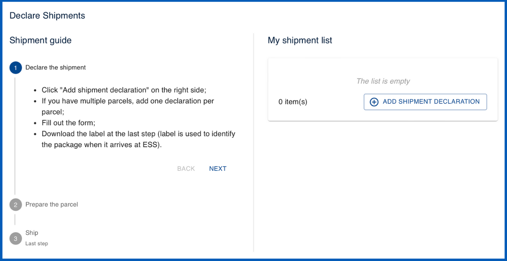

# Shipment declaration templates :material-truck:

_____________________________________________________________________________________________________

## What are shipment declaration templates?

Shipment declaration templates :material-truck: are standardized forms used to collect and organize information about parcels being sent to a facility. These templates can be customized to guide users through the process of declaring each shipment, generating labels for package identification, and ensuring compliance with shipping protocols. Each parcel's details, including tracking information and handling instructions, are documented to facilitate smooth and traceable delivery to the facility.

> **_NOTE:_** The shipment declaration form will only become accessible for users to fill out after their proposal status has been set to 'accepted' and the experiment has been allocated a time within the scheduler.

<figure markdown="span">  
        { width="450"}
        <figcaption>Shipment declaration (viewed from the user's perspective)</figcaption>
    </figure>

## Customize the shipment label PDF

Open a shipment declaration template and select **Edit shipment label PDF**.
Edit the HTML layout, use **Insert answer** to add an answer from the questionnaire, and select **Preview** to check the layout with sample data. Select **Save layout** to make it available for downloads.

- Use **Insert barcode** or **Insert QR code** to add `{{shipmentBarcode}}` or `{{shipmentQrCode}}`. CSS controls placement; the stored shipment reference controls what the codes encode.
- A missing answer renders as blank. To hide the entire line when the answer is missing, wrap it in a condition:

  ```handlebars
  {{#if (lookup answers "handling_notes")}}
    <p>Handling: {{lookup answers "handling_notes"}}</p>
  {{/if}}
  ```

- Only include information intended to be visible on a parcel. The built-in layout does not print questionnaire answers by default.
- Downloads, including reprints, use the latest layout saved on the shipment's original declaration template. Select **Restore default** to remove a custom layout.

_____________________________________________________________________________________________________
